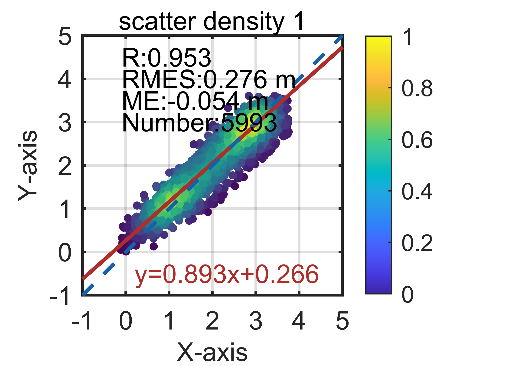
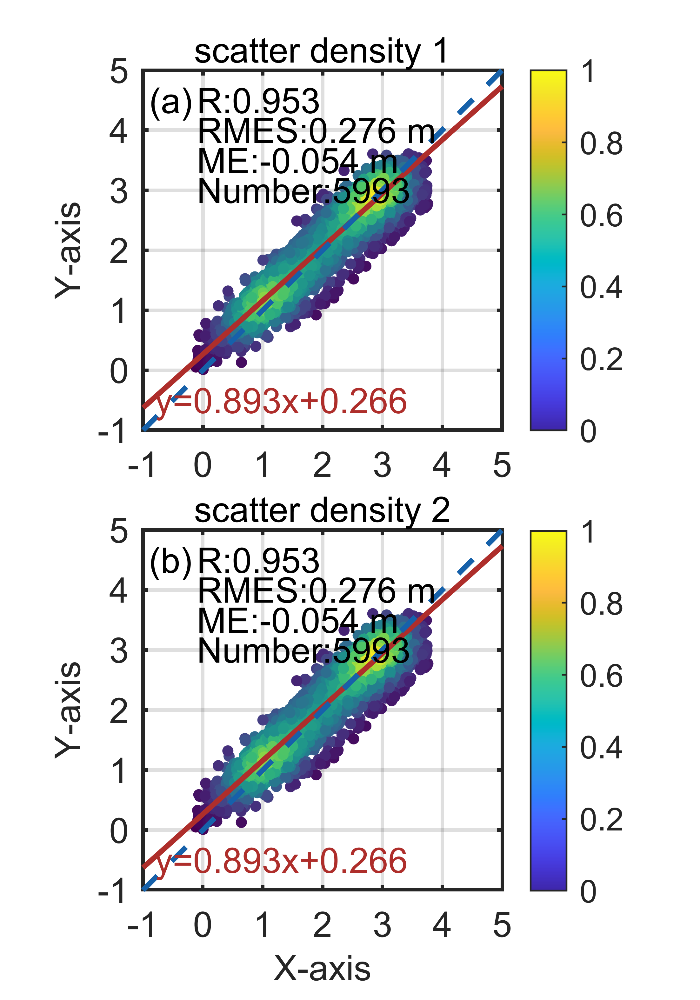
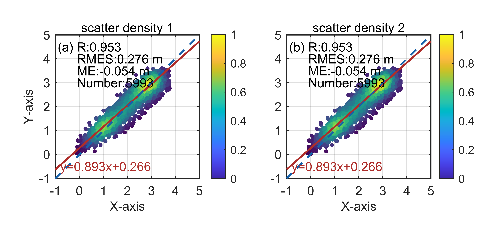
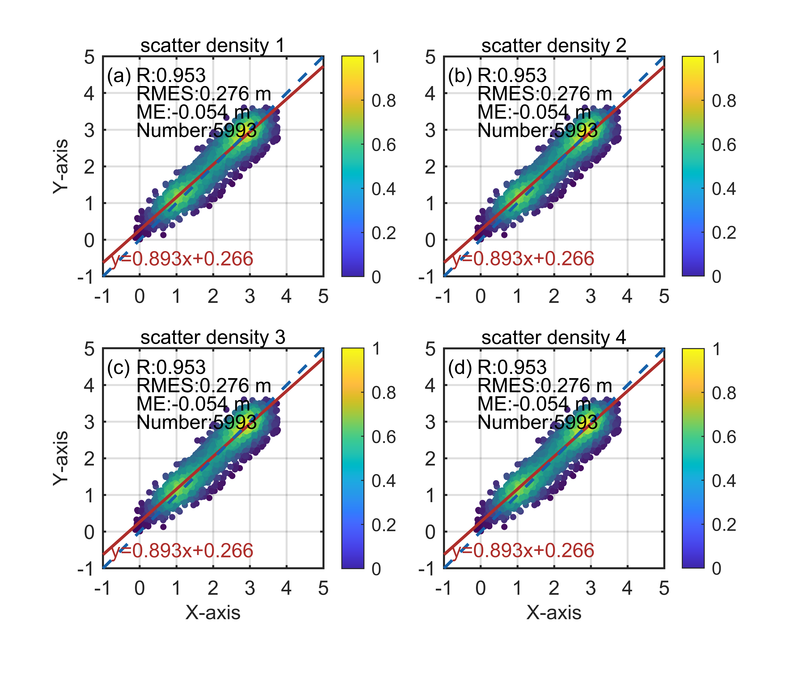
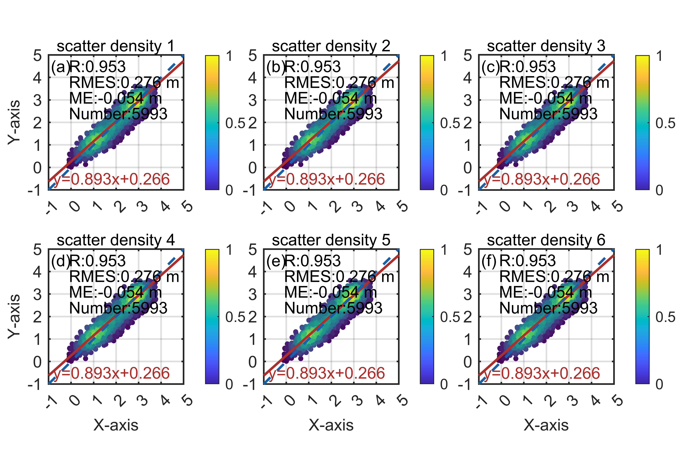
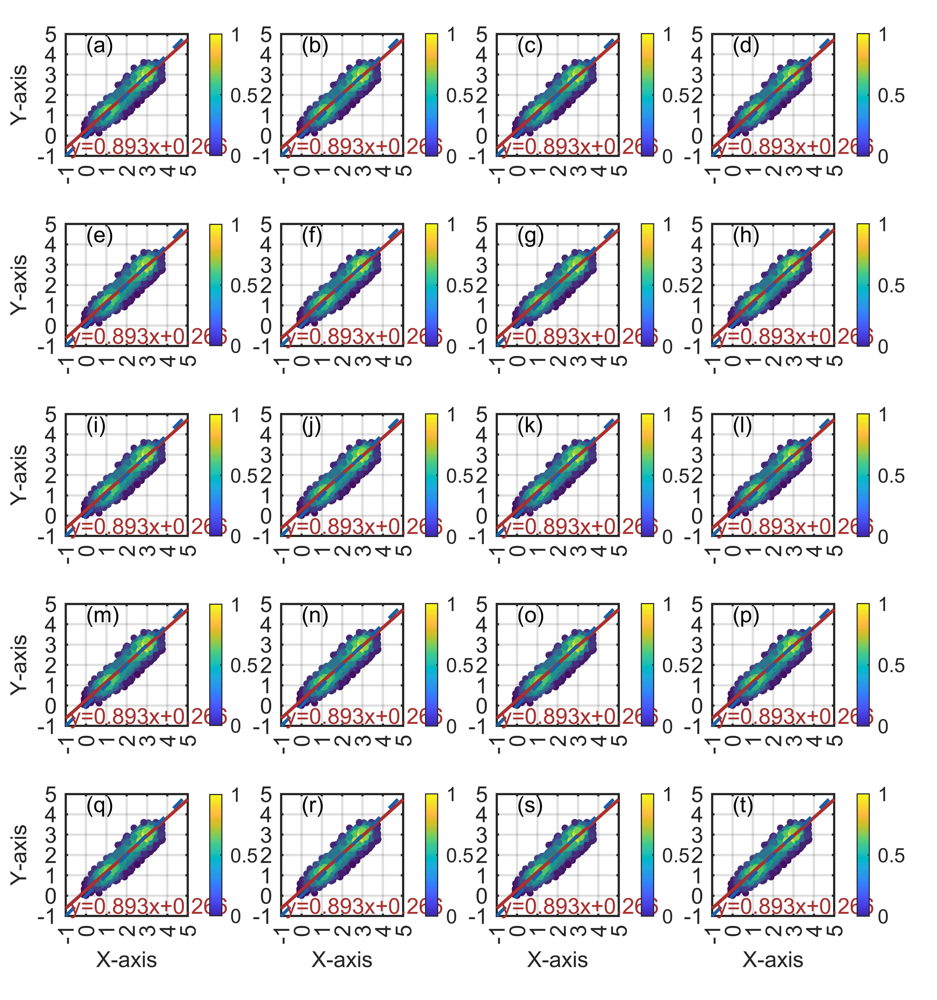

# MATLAB | Research Plotting Issue 18: Scatter Density Plot

1. Finished the day's work of drawing figures according to the technical requirements, completing tutorials for various figure sizes such as 1x1, 2x1, 1x2, 2x2, 2x3, and 5x4. This also allows for future code-based image generation, where only the x and y axis data need to be replaced to produce an image. Let's see it together...
The following diagram involves four subfunctions:
It is necessary to explain why figureWidth is set to 8.5. This is because there is limited space for inserting figures when using a double column layout.
How is this calculated? The A4 paper size is defined by ISO 216: 210mm×297mm. This standard is used worldwide, with most countries adopting it.
The margins required for papers are: top (T) - 25 mm; bottom (B) - 25 mm; left (L) - 20 mm; right (R) - 20 mm.
This means that papers must be printed on A4 standard white paper, leaving enough blank edges for binding, copying, and annotation. Each side should have margins of 25mm at the top and bottom, and 20mm at the left and right sides. This is relative to general submission journals.
Therefore, 210mm - 20mm - 20mm = 170mm. In a double-column layout, the space available for placing images in a single column is only 85mm, or 8.5cm. Only by doing so can the font size in the resulting image remain unchanged when imported into Word. If the figure size is 10cm, after being imported into Word, it will be compressed to 8.5cm, which would result in the font size of the 10-point font being reduced, no longer being the original 10-point font. This explains why some SCIs show varying font sizes within each figure.

## Images

<!-- PAYMENT_BLOCK -->

## Get this dataset

- Payment link (Stripe): [Buy now](https://buy.stripe.com/3cs8yP7sY87d0vu9AB)
- Payment QR code: 

<!-- /PAYMENT_BLOCK -->
